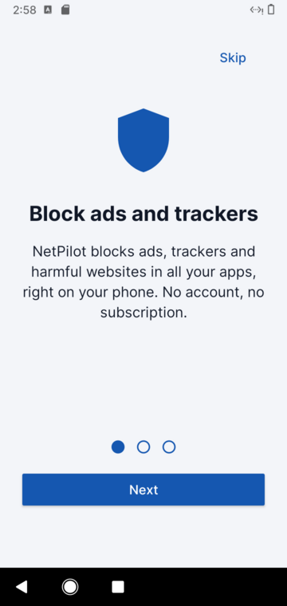
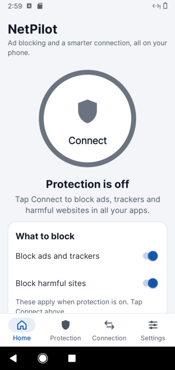
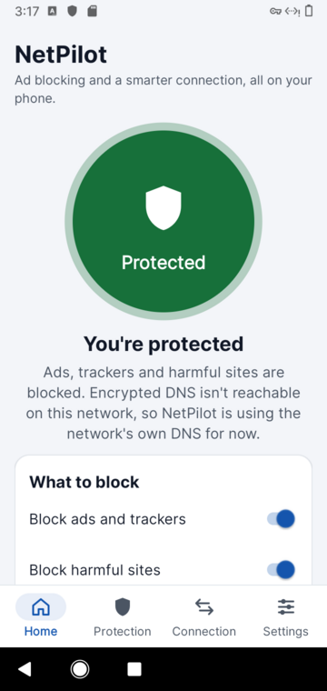
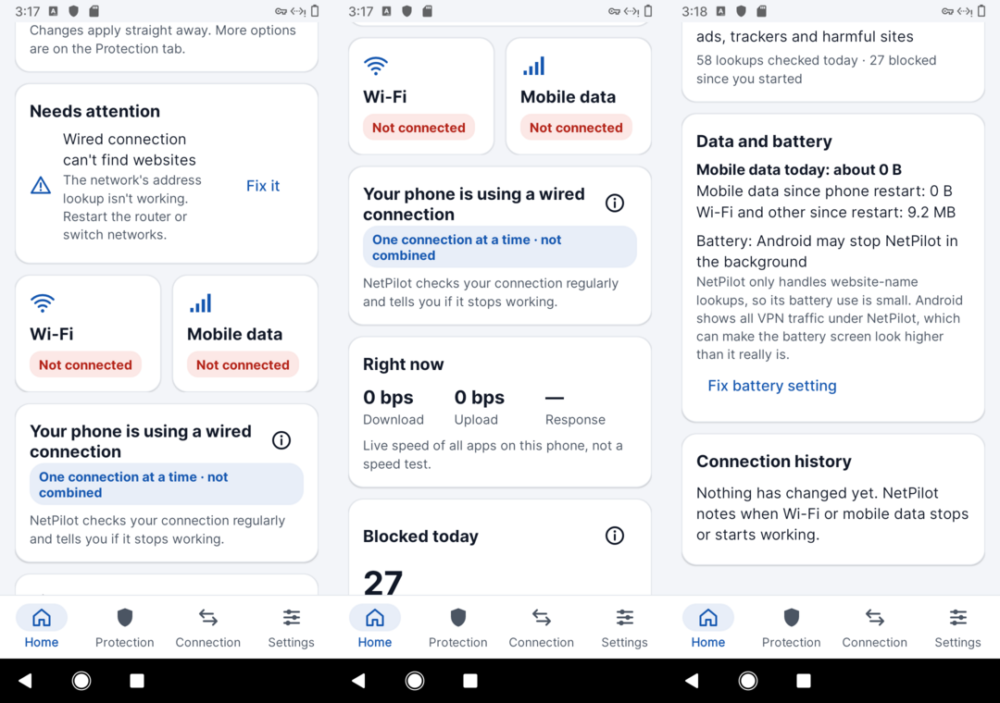
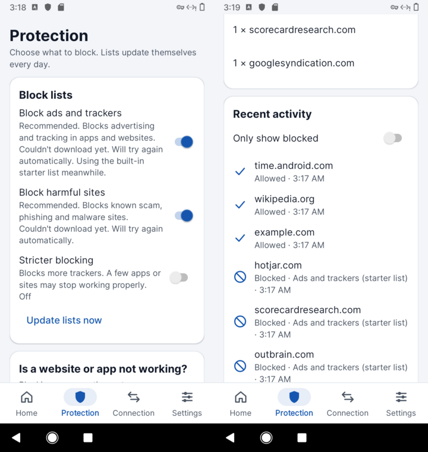
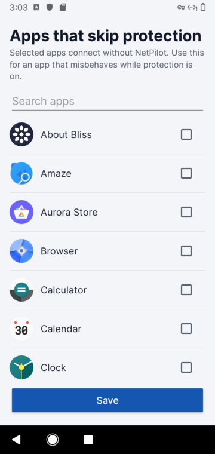
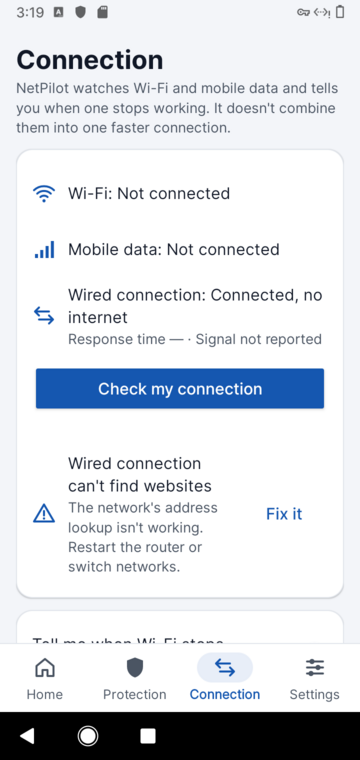
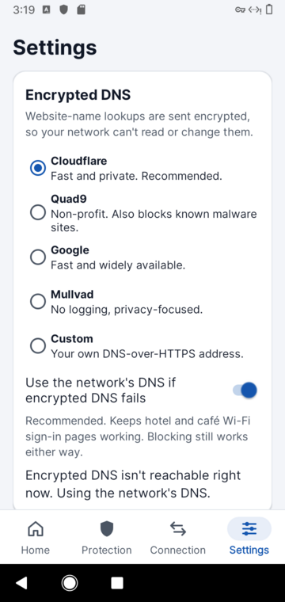
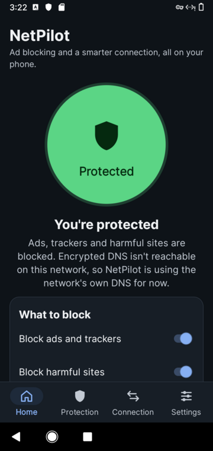
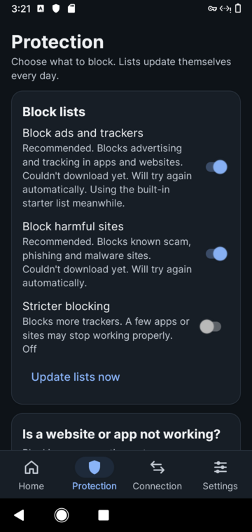

# Phase 3: user experience redesign

NetPilot 0.2.2. Screens are from a real Android 11 system (BlissOS 14 x86_64 in QEMU), set to a phone-sized
720×1520 portrait screen. The emulated network has no working DNS and blocks encrypted DNS, so some screens show
"can't find websites" and the plain-DNS fallback message. That's the test environment, not the app.

## 1. Design principles

| Principle | What it means in NetPilot |
|---|---|
| **One main action** | A single big **Connect** button. Everything else is secondary. |
| **Plain words first** | "Connected, no internet", not `NET_CAPABILITY_VALIDATED=false`. Technical detail only under *Show advanced options*. |
| **Never colour alone** | Every state has a colour **and** an icon **and** words (button label, chip text). |
| **Honest by default** | The Home screen says the connection is **not combined** (no bonding). Blocked counts are lookups, not "ads". Data use says "about". |
| **Fix, don't just report** | Every problem card has one plain next step and, where possible, a **Fix it** button that opens the right Android setting. |
| **Progressive disclosure** | Home → Protection/Connection tabs → *Show advanced options* → *Technical details*. |
| **Calm motion** | Short fades, a soft pulse while protected, a count-up on the blocked number. All off when Android's "Remove animations" is on. |

## 2. Structure

```
Introduction (first run only, 3 pages)
└── Main screen, four tabs (bottom bar)
    ├── Home ........... status at a glance, Connect, what to block, problems, speed, data, history
    ├── Protection ..... block lists, pause, allow/block sites, apps that skip, activity
    │   └── Apps that skip protection (picker)
    ├── Connection ..... each network in words, "Check my connection", alerts, backup, advanced
    └── Settings ....... encrypted DNS, Always on, battery, privacy, help, about
Outside the app: notification (status + Pause/Turn off), Quick Settings tile, Wi-Fi alert, crash report on next launch
```

## 3. Screen by screen

### 3.1 Introduction (first launch)


Three pages: **what it does** (blocks ads, trackers and harmful sites in every app), **what it honestly doesn't do**
(it watches Wi-Fi and mobile data and alerts you; it does not combine them), and **why Android will ask** for the VPN
permission (lookups are checked on the phone, nothing goes to a NetPilot server).
*Turn on protection* asks for notifications first, then the VPN, one prompt at a time. *Skip* and *Not now* are always available.

### 3.2 Home, protection off


- **Connect** (220 dp, labelled, TalkBack reads "Turn protection on, button").
- Status in a sentence: *Protection is off. Tap Connect to block ads, trackers and harmful websites in all your apps.*
- **What to block**: the two main switches right on Home, in step with the Protection tab. The note under them
  explains that they apply once protection is on.

### 3.3 Home, protected



| Card | Content | Why |
|---|---|---|
| Status | Green button "Protected", *You're protected*, what's blocked, whether DNS is encrypted | Instant reassurance |
| What to block | Ads and trackers / Harmful sites switches | The easy ad-blocking toggle from the brief |
| Needs attention (only if needed) | Up to 3 plain problems, each with **Fix it** | Troubleshooting without jargon |
| Wi-Fi / Mobile data | Chip: *Working · Excellent*, *Connected, no internet*, *Needs sign-in*, *Not connected* | Status in words, colour as a hint |
| Your phone is using … | Chip: **One connection at a time · not combined**, or **Switched to mobile data 3 minutes ago · not combined** | Answers "bonded, single or switching?" plainly. ⓘ explains why there's no bonding. |
| Right now | Download, Upload, Response (live, all apps) | Real-time speed and latency |
| Blocked today | Big counter (counts up), lookups checked, total since start; ⓘ explains what counts | Honest statistics |
| Data and battery | **Mobile data today: about …**, since restart, battery permission status with **Fix battery setting** | Data use and battery from the brief |
| Connection history | *Wi-Fi is connected but has no internet*, *Phone switched to mobile data*, with times; kept across restarts | Connection history |

### 3.4 Protection


Block lists with size and "updated N minutes ago" · **Update lists now** · *Is a website or app not working?* →
**Pause for 5 minutes**, **Allow a website** · Apps that skip protection → picker · your allowed and blocked sites
(each removable) · Most blocked today · **Recent activity**: tap a blocked line to allow it, or an allowed one to block it.

### 3.5 Apps that skip protection


Search, app icons and names, a checkbox per app; TalkBack reads "Skips protection" or "Protected".
**Save** reconnects the VPN with the new list in about a second.

### 3.6 Connection


Each network in one line (*Wi-Fi: Working · Good*, with response time and signal in words) · **Check my connection** →
*Everything looks good.* or plain problems with **Fix it** · *Tell me when Wi-Fi stops working* · *Keep mobile data
ready as a backup* (with its battery cost) · *Open the phone's internet settings* · **Show advanced options**:
which network NetPilot's own traffic uses, the two-network download test, and technical details.

### 3.7 Settings


Encrypted DNS provider (one line each on why you'd pick it) · *Use the network's DNS if encrypted DNS fails* (why:
hotel Wi-Fi sign-in) · live status (*Encrypted DNS is working ✓*) · Always on, with step-by-step text · Run in the
background · *Also filter apps that use their own DNS* · privacy statement · Troubleshooting tips · Show the
introduction again · About, with list credits.

### 3.8 Dark mode



Separate dark palette. Every text pair still meets WCAG AA (§5).

### 3.9 Outside the app
- **Notification** (always while protected): *You're protected · 1,234 blocked today*, with **Pause 5 min** and **Turn off**.
- **Quick Settings tile**: one tap on/off. It opens the app the first time, for the permission.
- **Wi-Fi alert**: *Wi-Fi isn't working. Wi-Fi is connected but has no internet. Tap to check, or switch to mobile data.*
  At most every 10 minutes, and it can be turned off.
- **Protection turned off** alert when another VPN app takes over.
- **Crash report**: if the app ever closes unexpectedly, the next launch offers the details to copy (stays on the phone).

## 4. Key journeys

| # | Situation | Steps | Taps |
|---|---|---|---|
| J1 | First use | Intro → *Turn on protection* → allow notifications → allow VPN → **Protected** | 5 |
| J2 | Daily check | Open app → Home answers: protected? which network? anything wrong? how much blocked? | 0 |
| J3 | "A site is broken" | Protection → *Pause for 5 minutes* → works → Recent activity → tap the blocked name → *Allow* | 4 |
| J4 | "Wi-Fi says connected but nothing loads" | Alert notification → Home *Needs attention: Wi-Fi is connected but has no internet* → **Fix it** (internet panel) → switch to mobile data | 2–3 |
| J5 | "Is this eating my data/battery?" | Home → Data and battery: today's mobile data, battery status, **Fix battery setting** if needed | 0–1 |
| J6 | Another VPN in use | Connect → *Another VPN is active* explanation → choose | 2 |
| J7 | Expert | Connection → *Show advanced options* → mode, two-network test, technical details | 2 |

## 5. Accessibility (checked, not assumed)

| Check | Result |
|---|---|
| Text contrast (WCAG AA 4.5:1), every foreground/background pair, light and dark | **All pass** after darkening the light-theme green (`good` text on its chip: 4.43 → 5.38:1). Lowest pair: 4.83:1. |
| Touch targets | Buttons ≥ 48 dp, switches/rows ≥ 56 dp, the Connect button 220 dp, info buttons 48 × 48 dp |
| Text size | `sp` units throughout; the Connect label honours Android 14's non-linear font scaling |
| Screen readers | Headings marked (`accessibilityHeading`), live regions for status and results, Connect announced as a button with its state, network cards and stat cells read as one sentence, app picker announces "Skips protection/Protected" (Android 11+) |
| Colour independence | Every state also has words and an icon |
| Motion | Pulse, fades and count-up are skipped when animations are off |
| Long-press tooltips | Bottom tabs and ⓘ buttons |

## 6. Brief → delivery

| Phase 3 requirement | Where | Status |
|---|---|---|
| Prominent Connect/Disconnect | Home, notification, Quick Settings tile | Done |
| Clear Wi-Fi and mobile-data status | Home cards, Connection tab | Done |
| Real-time down/up speed, latency, quality | Home *Right now*, network chips | Done (speed is the whole phone's live traffic; latency is the HTTPS response time of the probe) |
| Bonded vs single vs switching, simply | Home mode chip + ⓘ explanation | Done. It always says **not combined**, because NetPilot doesn't bond. |
| Easy ad-blocking toggle | Home *What to block* (and Protection tab) | Done |
| Blocked-ad/tracker statistics where measurable | Home counter, Protection activity and top list | Done, as lookups (exactly measurable), with an explanation |
| Mobile-data consumption | Home: today (approximate) and since restart | Done. "Today" is an estimate from Android's counters (§7). |
| Battery usage | Home: battery permission status, explanation, fix | Partial by design (§7) |
| Connection history | Home, kept across restarts (last 50) | Done |
| Troubleshooting, useful notifications | Needs attention + Fix it, Troubleshooting tips, 4 notification types | Done |
| Plain language, icons, accessible text | Whole app | Done (§5) |
| Helpful animations, tooltips | Pulse, fades, count-up, ⓘ dialogs, long-press tooltips | Done |
| Guided onboarding | 3-page introduction, re-openable from Settings | Done |
| Advanced section | Connection → *Show advanced options* | Done |

## 7. Honest limits

- **Battery**: Android doesn't let an app read its own share of battery use reliably, and it credits all VPN traffic to
  the VPN app. NetPilot explains this and links to Android's battery settings, but shows no invented percentage.
- **Mobile data "today"** is counted from Android's cumulative counters whenever NetPilot runs. It's exact within a
  boot and slightly low across midnight, so it's labelled "about". Per-app figures would need usage access, which
  NetPilot deliberately doesn't request.
- **"Ads blocked"** can't be counted exactly at DNS level. NetPilot counts blocked lookups and says so.
- **Not bonding**: shown on Home, in the introduction and in the ⓘ explanation.

## 8. Found and fixed while taking these screenshots

Running the redesign on a real Android system turned up six problems that tests had not caught:

| Seen on screen | Cause | Fix |
|---|---|---|
| "Your phone is using another connection" while on a cable | Android reports NetPilot's own VPN as the default network | Home looks past the VPN to the real connection, so it now says "wired connection" (and shows the right response time) |
| "Update failed, using the previous list" when there was no previous list | One message for every failure | Separate messages: *Couldn't download yet… using the built-in starter list meanwhile*, *Update failed. Still using the list from 2 hours ago*, *Off* |
| Switched-off "Stricter blocking" said "Will download when protection is on" | Same | Shows *Off* |
| After switching to dark mode, list status lost its error | The list manager didn't remember its last errors | Last errors are kept, and *Downloading soon…* shows while protection is on |
| Connection tab omitted the wired link actually in use | Only Wi-Fi and mobile rows were drawn | Any other active connection is listed too |
| Light-theme green chip text 4.43:1 | Colour slightly too light | Darkened to 5.38:1 |

## 9. Verification

| Check | Result |
|---|---|
| Unit tests (core logic incl. daily-usage meter) | 40 pass |
| Robolectric: every tab drawn in every protection state, introduction, app picker, crash dialog, on Android 10, 11, 13, 14, 15 | 20 pass |
| Real Android 11 system: install, introduction, connect, blocking, allow, exclusions, pause/resume, disconnect, all screens, light and dark, 0.2.2 | Pass, 0 crashes |
