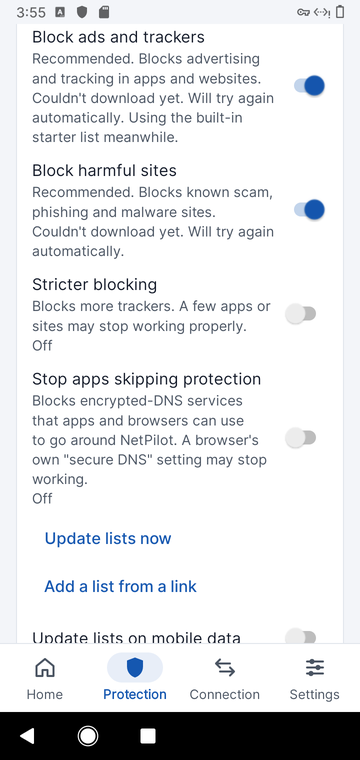
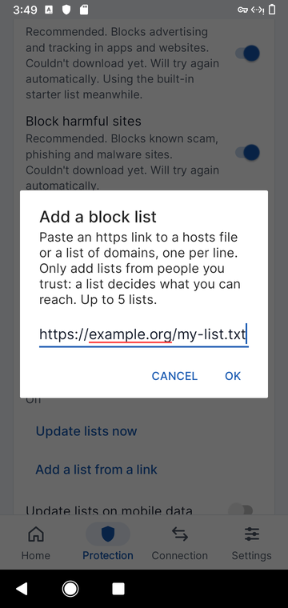
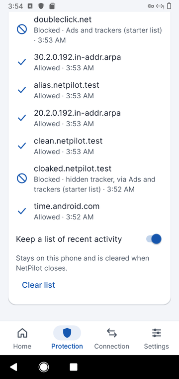
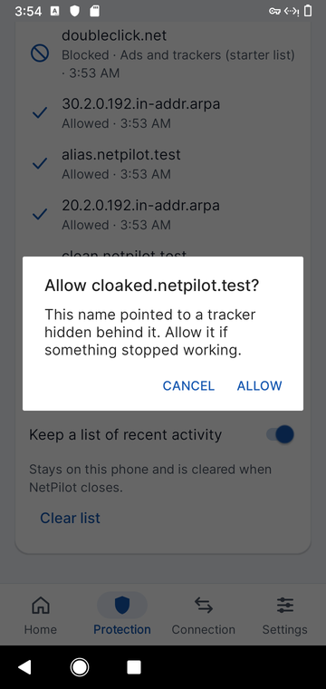

# Phase 5: Ad blocking, what DNS filtering can and can't do

NetPilot 0.2.4. **Short version:** NetPilot blocks ads, trackers and harmful sites by checking every domain lookup
on the phone. This phase adds **hidden-tracker (CNAME) blocking**, **Firefox bypass protection**, an optional
**encrypted-DNS bypass list**, **your own lists from a link**, **data-friendly updates**, **safer updates** and a
**"report wrong block"** path. It can't remove ads served from the same domain as the content (YouTube, Facebook
and Instagram feeds). No DNS-only blocker can.

Evidence labels: **[V]** verified here (code, test or device run) · **[S]** secondary or public source · **[M]** estimate.

---

## 1. How it works (one VPN, DNS only)

```
 every app ──lookup──▶ Android resolver ──▶ NetPilot VPN (only 10.111.222.1 / fd00:6e70:696c::1 routed)
                                                │
                     1. user allow ▸ user block ▸ never-block ▸ lists  ── blocked ──▶ 0.0.0.0 / ::  (TTL 10 s)
                                                │ allowed
                     2. cache (30 s–1 h) or encrypted DNS (DoH, RFC 8484); plain DNS fallback if enabled
                                                │
                     3. answer is an alias (CNAME) to a blocked name? ── yes ──▶ 0.0.0.0 / ::  ("hidden tracker")
                                                │ no
                                                ▼
                                       real answer to the app
 web, video and app traffic ─────────────────────────────────▶ Wi-Fi / mobile data directly (never enters the VPN)
```

- **Android allows one VPN at a time** [S: VpnService reference]. Ad blocking, encrypted DNS and per-app exceptions
  therefore all live in one service (`ShieldVpnService`). If you turn on another VPN, Android stops NetPilot, and
  NetPilot tells you with a notification. It can't run alongside a work or privacy VPN, and nothing can change that
  without root.
- **Only DNS goes through the tunnel** [V: `establish()` routes two /32 and /128 addresses]. Speed, latency and
  battery cost stay low because packets aren't copied in user space.
- **Per-app exceptions** use `addDisallowedApplication` [V]. Those apps use the network's DNS and skip filtering.
- NetPilot's own sockets (DoH, list downloads, probes) are excluded from its own VPN, so they can't loop [V].

## 2. Brief → what was done

| Brief item | Status in 0.2.4 | Evidence |
|---|---|---|
| DNS-based blocking | Done (since 0.1). Blocked A/AAAA get `0.0.0.0`/`::`, other types NXDOMAIN, TTL 10 s so Pause/Allow apply within seconds. | [V] `Dns.blockedResponse`, DnsTest |
| **Hidden trackers (CNAME cloaking)** | **New.** Each allowed answer's CNAME chain is checked against the lists, including cached answers, so a list update applies at once. | [V] DnsTest (compression, loops, truncation), DomainSetTest, device |
| Filter lists | Ads (StevenBlack, on), Harmful (HaGeZi TIF medium, on), Stricter (HaGeZi PRO, off), **new: Stop apps skipping protection (HaGeZi encrypted-DNS bypass, off)**. A 70-domain starter list is used until the first download. | [V] `Blocklists.SOURCES` |
| Automatic updates | Daily, checked at start and **now every hour while running**. **New:** on mobile data, only lists that are missing or a week old update, unless *Update lists on mobile data* is on. *Update lists now* always downloads. | [V] `ListPolicy.shouldFetch`, ListPolicyTest |
| Custom allow / block | Done (since 0.2). Allow beats block; covers subdomains. | [V] DomainSetTest |
| **Custom lists** | **New.** Up to 5 https links (hosts or domain-per-line format). Tap and hold to remove. | [V] device: add, download attempt, remove |
| Per-app exceptions | Done (since 0.2). | [V] e2e on device |
| Statistics and logs | Done. Counts are **lookups**, not "ads". Activity log is in memory, can be turned off, and now shows *hidden tracker, via …*. | [V] device screenshot |
| False positives | Pause 5 min · tap a blocked line → Allow · **new: Report wrong block** (copies the name, opens the list maker's public issue page) · **new: never-block list** for Android's connectivity, time and push checks. | [V] tests; report link not run on device (§6) |
| Troubleshooting | Phase 3 *Needs attention* cards, including the Private DNS warning. | [V] Phase 3 |
| Encrypted DNS | DoH to Cloudflare, Quad9, Google, Mullvad or a custom https URL; optional plain fallback, shown in the app when used. | [V] `Upstream` |
| Secure filter updates | HTTPS only, system CAs only, 48 MB cap, ETag, atomic replace, minimum size, **new: shrink guard** (a list that loses >50 % of its entries is rejected and the old copy kept), **new: one update at a time**. | [V] `ListPolicy.rejectReason`, ListPolicyTest |
| Privacy controls | No NetPilot server or analytics. Activity log can be turned off and cleared. Backups disabled. See §5. | [V] manifest, Prefs |
| **Firefox bypass** | **New.** `use-application-dns.net` gets "no such domain", which tells Firefox not to switch on its own DoH [S: Mozilla canary]. | [V] device: answered locally, never sent upstream |

## 3. NetPilot vs AdGuard for Android (functional comparison only)

AdGuard is the reference for *what users expect*, not code to copy. No AdGuard code, rules or branding are used.

| Capability | AdGuard for Android [S] | NetPilot 0.2.4 | Why the difference |
|---|---|---|---|
| DNS blocking with lists | Yes | Yes | |
| CNAME uncloaking | Yes | **Yes (new)** | |
| Element hiding (cosmetic rules) | Yes, in browsers it can filter | No | Needs the page content: HTTPS interception or a browser extension |
| Same-domain ads (YouTube, in-feed social ads) | Partly, with HTTPS filtering | **No** | The ad and the video come from the same domain. Blocking it blocks the video. |
| HTTPS filtering | Yes, installs its own CA; on Android 7+ most apps ignore user CAs unless rooted [S: AdGuard compatibility docs] | **No, by design** | Intercepting TLS weakens every connection and needs a trusted root. NetPilot never sees page content. |
| Full-traffic VPN | Yes (routes all traffic) | No (DNS only) | Lower battery and latency cost, and no traffic inspection |
| Firewall per app | Yes | Skip-protection per app only | Out of scope |
| Encrypted DNS | DoH/DoT/DoQ/DNSCrypt | DoH | DoH runs over 443 and is the most widely supported; the others add code without a clear user benefit here |

**Google Play note [S]:** Play's VpnService policy restricts VPN apps that block ads in *other* apps. NetPilot is
built for side-loading. Publishing on Play would need a policy review first.

## 4. Honest limits of DNS filtering

| Limit | What happens | What NetPilot does |
|---|---|---|
| Same-domain ads | YouTube and social-feed ads still show | Says so; no fake claims |
| Apps with built-in encrypted DNS (DoH/DoT) | Their lookups skip the VPN's DNS | Optional bypass list blocks known DoH hosts; *Also filter apps that use their own DNS* routes 8 well-known resolver IPs into the tunnel. Neither is complete. |
| Browser "secure DNS" set manually | Bypasses NetPilot | Bypass list (if on). Firefox's automatic DoH is stopped by the canary. Chrome only auto-upgrades for known DoH resolvers, and NetPilot's resolver isn't one [S: Chromium blog]. |
| Android Private DNS = a hostname | Android sends DNS to that DoT server and NetPilot sees nothing | *Needs attention* card tells you to set Private DNS to Automatic or Off |
| Hard-coded IP addresses | No lookup, nothing to block | None possible at DNS level |
| Apps excluded by you | Not filtered | By design |
| Lists are not signed | Maintainers publish over HTTPS on GitHub, without signatures | TLS with system CAs, size cap, minimum size, shrink guard, never-block list; the previous good copy stays in use |
| Counting "ads" | One lookup isn't one ad | Counts lookups and says so |

## 5. Privacy

| Data | Where it goes |
|---|---|
| Your lookups | The DoH provider you choose. If plain fallback is used, the network's DNS server. No NetPilot server exists. |
| List downloads | `raw.githubusercontent.com` (or your custom list host) sees your IP address and NetPilot's user agent, about once a day |
| Activity log | Memory only, last 300 lookups, cleared when NetPilot closes; can be turned off |
| Counters, settings, allow/block lists | App-private storage; excluded from cloud and device-to-device backup |
| Report wrong block | Only if you tap it: the domain is copied for **you** to paste on a public GitHub page. NetPilot sends nothing. |

## 6. Verification

| Check | Result |
|---|---|
| Core unit tests (now incl. CNAME parsing with compression, pointer loops and truncation; alias blocking; never-block; update policy; shrink guard) | **50 pass** |
| Robolectric: every tab in every protection state, Android 10/11/13/14/15 | **20 pass** |
| Real Android 11 (BlissOS, QEMU), 0.2.4, with a local test DNS server | see below |

Device run (the VM has no internet, so a small test DNS server answered fixed names; NetPilot used its plain-DNS
fallback to reach it):

| Lookup | Without NetPilot | With NetPilot |
|---|---|---|
| `cloaked.netpilot.test` → CNAME `ads.doubleclick.net` | 192.0.2.10 | **blocked** (0.0.0.0), logged *hidden tracker, via Ads and trackers (starter list)* |
| `clean.netpilot.test` | 192.0.2.20 | 192.0.2.20 (unchanged) |
| `alias.netpilot.test` → CNAME `cdn.netpilot.test` (not listed) | 192.0.2.30 | 192.0.2.30 (unchanged) |
| `use-application-dns.net` | — | "no such domain", answered by NetPilot (0 queries reached the server) |
| `doubleclick.net` | — | blocked |
| Tap the hidden tracker → **Allow**, look up again | | 192.0.2.10 (allowed within seconds) |
| Add a list from a link, then tap and hold → Remove | | Added, download tried, removed |
| Crashes | | **0** |






**Not verified on a device:** the *Report wrong block* button appears only for downloaded lists, and the offline
VM can't download them. The mobile-data policy and the shrink guard are covered by unit tests, not a device run.

## 7. Bugs found while building this phase

| Found | Effect if shipped | Fix |
|---|---|---|
| `DomainFilter.ALLOW_ALL` was created before the never-block set it reads | **App would crash on start** (class failed to load) | Caught by the new unit tests; declaration order fixed and commented |
| A manual and an automatic update could run at the same time | Two downloads of the same list | One update at a time (`AtomicBoolean`) |

## Sources

- Android `VpnService` (one VPN at a time, per-app exclusion): https://developer.android.com/reference/android/net/VpnService
- Google Play VpnService policy: https://support.google.com/googleplay/android-developer/answer/12564964
- AdGuard for Android settings and HTTPS-filtering compatibility: https://adguard.com/kb/adguard-for-android/features/settings/ · https://adguard.com/kb/adguard-for-android/solving-problems/compatibility-issues/
- AdGuard on CNAME tracking: https://www.theregister.com/2021/03/04/adguard_cname_tracker/
- CNAME cloaking research: Dimova et al., "The CNAME of the Game", PETS 2021: https://petsymposium.org/2021/files/papers/issue3/popets-2021-0053.pdf · https://portswigger.net/daily-swig/web-trackers-using-cname-cloaking-to-bypass-browsers-ad-blockers
- Firefox canary domain: https://support.mozilla.org/en-US/kb/canary-domain-use-application-dnsnet
- Chrome DoH auto-upgrade: https://blog.chromium.org/2020/05/a-safer-and-more-private-browsing-DoH.html
- Android Private DNS: https://android-developers.googleblog.com/2018/04/dns-over-tls-support-in-android-p.html
- DNS-over-HTTPS: RFC 8484, https://www.rfc-editor.org/rfc/rfc8484
- Lists: https://github.com/StevenBlack/hosts · https://github.com/hagezi/dns-blocklists
